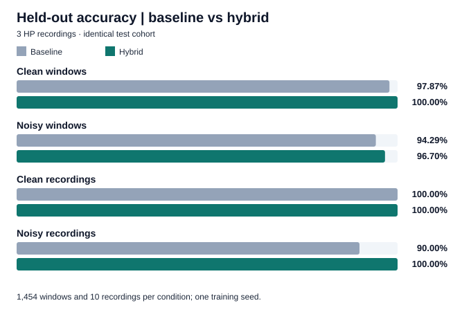
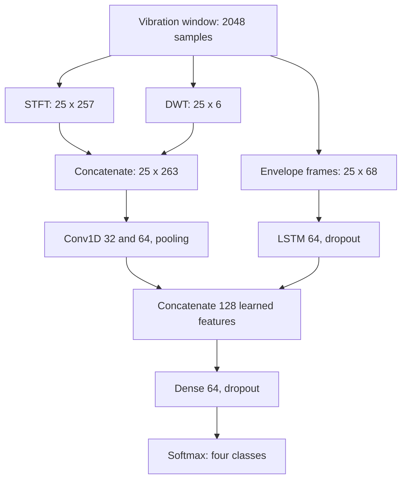

# Bearing Fault Diagnosis Using a Hybrid 1D-CNN–LSTM

Fifth-semester Electronics and Communication Engineering project at **Birla Institute of Technology, Mesra**. The project identifies Healthy, Inner Race, Ball and Outer Race conditions from CWRU vibration signals using STFT, DWT and Envelope features.

**Updated 26 November 2026 — primary hybrid experiment completed.** Both models were trained locally by the project team on the same recording-separated data. The results below are from the saved run, not simulated values.

## Experimental results

| Held-out test metric | STFT + DWT 1D-CNN | STFT + DWT + Envelope hybrid |
|---|---:|---:|
| Clean window accuracy | 97.87% | **100.00%** |
| Noisy window accuracy | 94.29% | **96.70%** |
| Clean macro-F1 | 0.9778 | **1.0000** |
| Noisy macro-F1 | 0.9400 | **0.9657** |
| Clean window log loss | 0.053241 | **0.001823** |
| Noisy window log loss | 0.239870 | **0.064412** |
| Clean recording accuracy | 10/10 | 10/10 |
| Noisy recording accuracy | 9/10 | **10/10** |



The hybrid reduces noisy window errors from 83 to 48 (42.17%) and improves noisy accuracy by 2.41 percentage points. All 48 remaining noisy window errors are Inner Race predicted as Outer Race. Each condition contains 1,454 test windows drawn from 10 held-out recording groups; overlapping windows and paired variants are not independent experiments. Results use one seed (42). This comparison evaluates the combined model and feature set, not the isolated contribution of LSTM or Envelope.

- [Full experimental report](reports/hybrid/2026-11-26/README.md)
- [Raw experiment results](reports/hybrid/2026-11-26/results.json)
- [Metrics CSV](reports/hybrid/2026-11-26/metrics.csv) · [Per-class metrics](reports/hybrid/2026-11-26/per_class_metrics.csv)
- [Learning curves](reports/hybrid/2026-11-26/learning_curves.svg) · [Confusion matrices](reports/hybrid/2026-11-26/confusion_matrices.svg)
- [Original graphs and saved model artifacts](https://drive.google.com/drive/folders/1RCVT_pJwR7g_njQP1bRmwgwDp3ilPkZb)

## Dataset and architecture

40 CWRU drive-end recordings, four classes and four motor loads (0–3 HP). The expanded dataset contains 5,592 paired windows (11,184 clean/noisy inputs), sampled at 12 kHz after resampling where required. Each window has 2,048 samples (170.67 ms); transform frames are 512 samples with a 64-sample hop.

| Split | Motor load | Recording groups | Clean + noisy windows |
|---|---|---:|---:|
| Train | 0–1 HP | 20 | 5,378 |
| Validation | 2 HP | 10 | 2,898 |
| Test | 3 HP | 10 | 2,908 |



STFT uses a 512-point Hann FFT; DWT uses db4, five levels and six logarithmic mean-square subband features. The supplied Envelope sequences are aligned with the vibration windows. STFT/DWT are regenerated from those exact signals. Normalization is fitted only on training inputs. The loader verifies clean windows against hash-pinned raw MAT recordings and keeps recording groups disjoint. Envelope channel definitions and extraction provenance still need independent verification.

## Reproduce the experiment

Use Python 3.11 (the recorded run used TensorFlow 2.21.0). Clone or download this repository, then install dependencies:

```bash
python -m venv .venv
# Activate the environment for your platform
python -m pip install -r requirements.txt
```

Download the [numerical feature dataset](https://drive.google.com/drive/folders/1qR96FcLrIDfTck5qRwqEBCpYKuxXntJG), extract it locally so that `data/raw/envelope/train_70` and `data/raw/envelope/test_30` exist, and retain the raw MAT files under `Datasets/RAW/CWRU Dataset`.

```bash
python -m src.run_hybrid_experiment --dataset data/raw/envelope --check-only
python -m src.run_hybrid_experiment --dataset data/raw/envelope --epochs 30 --output models/hybrid_experiment
```

Alternatively open [the hybrid notebook](notebooks/06_hybrid_cnn_lstm.ipynb), set DATASET to the extracted folder, and run the cells in order. For each retraining use an empty output directory. The ZIP runner also accepts an archive with the expected split folders; an older unsplit ZIP does not satisfy this contract.

Trained models (original saved weights, hosted externally; Git keeps generated binaries out of source control):

- [Hybrid CNN–LSTM .keras](https://drive.google.com/file/d/1MZDk7G6kD8uGmWIBSsfH6CBJEdl-ohKI/view)
- [Baseline CNN .keras](https://drive.google.com/file/d/1e0ta1VzxsZzEn8zFI3ZmIAkIDKvFLFTK/view)

See [experiment instructions](docs/hybrid_experiment.md) and [architecture/data contract](docs/hybrid_cnn_lstm.md). The legacy Streamlit dashboard is a separate prototype, not a validated hybrid inference interface.

## Project status

| Work | Status |
|---|---|
| Engineering foundations and CWRU study | Complete |
| Raw ingestion, preprocessing and paired STFT/DWT features | Complete for the selected experiment |
| Envelope integration and hybrid model | Complete for the supplied arrays |
| Baseline CNN and hybrid evaluation | Complete — measured run archived |
| Learning curves, class errors and clean/noisy comparison | Complete |
| Independent Envelope extraction audit | Not completed |
| Ablation, multiple seeds, additional loads and external datasets | Deferred / future work |
| SVM/RF experiments and dashboard integration | Outside the current hybrid experiment scope; not validated |
| Final academic report, presentation and viva | Pending |

## Resources and history

- [Project roadmap](docs/roadmap.md) · [Study progress](docs/study_progress.md) · [Source inventory](docs/source_inventory.md)
- [Previous STFT/DWT experiment](docs/journal/2026-11-10.md) · [Hybrid experiment journal](docs/journal/2026-11-26.md)
- [Original feature dataset](Datasets/Features/README.md) · [Evaluation protocol](docs/data_and_evaluation_protocol.md)
- [M4 ingestion implementation](docs/m4_implementation.md) · [STFT/DWT audit](docs/stft_dwt_audit.md)
- [Literature survey](reports/literature_survey.md) · [Notebook guide](notebooks/README.md)
- [CWRU Bearing Data Center](https://engineering.case.edu/bearingdatacenter/welcome)

The prior CNN experiment used a different window cohort; its scores should not be substituted for the same-cohort baseline reported here.
