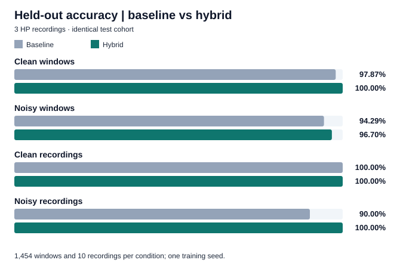
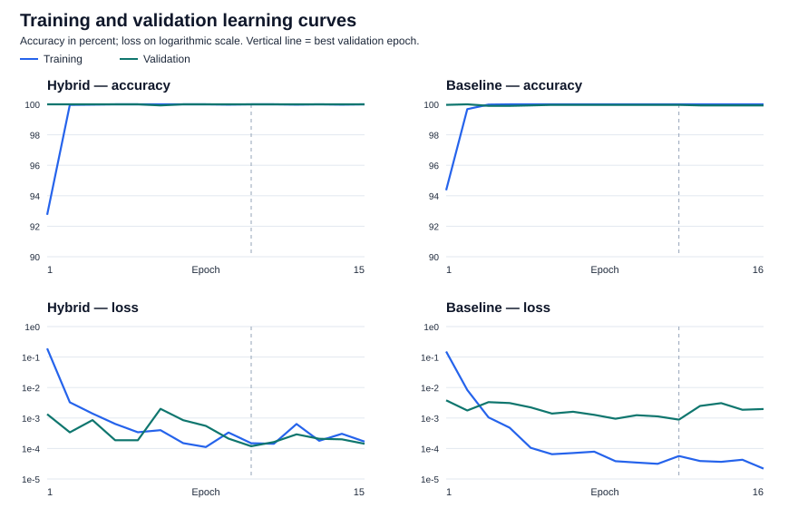
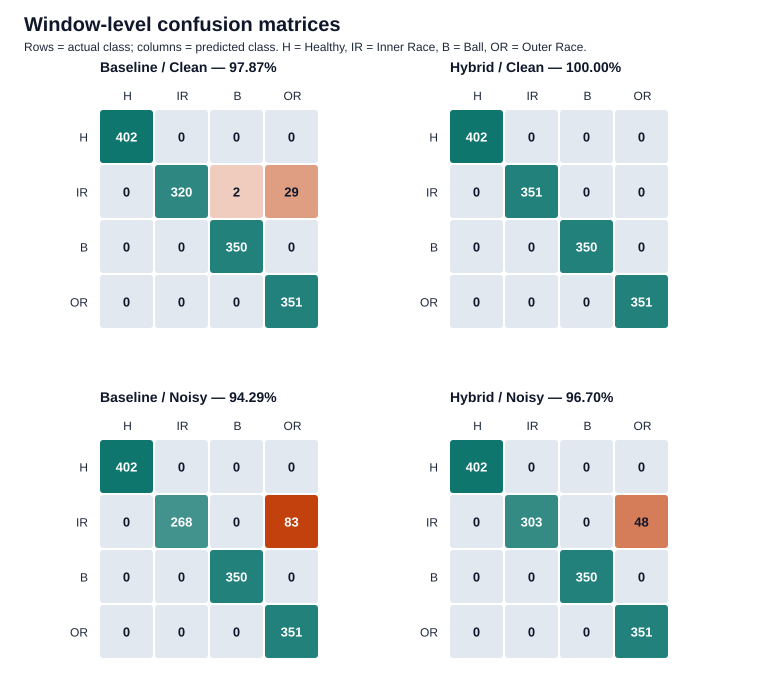

# Hybrid CNN–LSTM: measured experimental evidence

**Run completed locally on 26 November 2026.** Source: [original run exports](https://drive.google.com/drive/folders/1RCVT_pJwR7g_njQP1bRmwgwDp3ilPkZb). Training code: [PR #9](https://github.com/M4Rk9/bearing-fault-diagnosis/pull/9) and [PR #10](https://github.com/M4Rk9/bearing-fault-diagnosis/pull/10), merged into commit `04ca9b0192455b7ef0d5da0d3b0e03ca9cdd4993`. The source code was not retrained or modified for this archival update.

## Protocol

- 40 recording groups; 20 train (0–1 HP), 10 validation (2 HP), 10 test (3 HP).
- Train 5,378 / validation 2,898 / test 2,908 clean+noisy windows; 11,184 total.
- TensorFlow 2.21.0, seed 42; locked-manifest SHA-256 `7a6fc1737e3e21667a3cd615c05a464fc67eceab5a9d32101c085c0f671fcea0`.
- 2,048 samples per window, 12 kHz target rate. CNN input 25 x 263 (STFT + DWT), LSTM input 25 x 68 (Envelope).
- Adam, sparse categorical cross-entropy, batch size 64, maximum 30 epochs, early stopping with best validation-loss weights. Hybrid also uses learning-rate reduction; baseline retains its original architecture and callbacks.
- Recording-level prediction is the argmax of the mean window probabilities within a recording, evaluated separately for Clean and Noisy.

## Results

| Condition | Level | Baseline accuracy | Hybrid accuracy | Baseline macro-F1 | Hybrid macro-F1 |
|---|---|---:|---:|---:|---:|
| Clean | windows | 97.87% | 100.00% | 0.9778 | 1.0000 |
| Clean | recordings | 100.00% | 100.00% | 1.0000 | 1.0000 |
| Noisy | windows | 94.29% | 96.70% | 0.9400 | 0.9657 |
| Noisy | recordings | 90.00% | 100.00% | 0.9143 | 1.0000 |

The hybrid correctly classifies 1,454/1,454 clean and 1,406/1,454 noisy windows; the baseline classifies 1,423/1,454 and 1,371/1,454. The improvement is 2.13 and 2.41 percentage points respectively. Noisy log loss decreases from 0.239870 to 0.064412 (73.15% reduction). The baseline fails to classify one noisy recording (cwru-108, Inner Race predicted as Outer Race); the hybrid classifies it correctly.

## Learning curves

Hybrid training stops at epoch 15, with the best validation loss 0.00011869 at epoch 10 (training and validation accuracy both 100%). Baseline stops at epoch 16, with the best validation loss 0.00088527 at epoch 12 (training 100%, validation 99.9655%). Neither shows obvious underfitting on this cohort. The hybrid has no strong conventional overfitting pattern in this run; the baseline validation loss increases after its best epoch. Early stopping restores the best weights. Very high validation accuracy from the first epoch warrants caution and does not prove broad generalization.

## Error analysis

Under noise, all 48 hybrid errors and all 83 baseline errors are Inner Race classified as Outer Race. Inner Race recall improves from 76.35% to 86.32%; Outer Race precision from 80.88% to 87.97%. Healthy and Ball are perfectly classified under the evaluated conditions by both models. The reduction in noisy errors is 42.17%.

## Evidence and artifacts

- [results.json](results.json): preserved numerical run, histories, class IDs, group counts, all confusion matrices and record predictions.
- [metrics.csv](metrics.csv) and [per_class_metrics.csv](per_class_metrics.csv): original exported tables, checked against results.json.
- [results_and_discussion.md](results_and_discussion.md): original generated discussion.
- SVG figures in this directory are regenerated from the numerical run, not copies of the original PNGs.
- [Original report folder with all PNGs](https://drive.google.com/drive/folders/13eQTCnBH0Hcf01nm4vS5y70l-6UZ6kmm).
- [Hybrid weights](https://drive.google.com/file/d/1MZDk7G6kD8uGmWIBSsfH6CBJEdl-ohKI/view) and [baseline weights](https://drive.google.com/file/d/1e0ta1VzxsZzEn8zFI3ZmIAkIDKvFLFTK/view) remain on Drive; no binary model weights are committed. Access depends on Drive sharing. The weights are not independently reloaded or checksummed in this documentation update.

## Limitations and future scope

The test set contains only ten recording groups at one held-out motor load from one laboratory dataset. Overlapping windows and clean/noisy variants are correlated. A single seed cannot establish statistical significance or repeatability across initialization. The supplied Envelope extraction code and exact noisy-data generation need independent audit; do not assert a specific SNR for the hybrid dataset without verification. The observed improvements are for the joint architecture and feature set; ablation is deferred and individual causal contributions are not established. Additional noise levels, seeds, load rotation, external bearing data and deployment validation are future work. The older 4,643-pair CNN run is not directly comparable to this 5,592-pair experiment.
